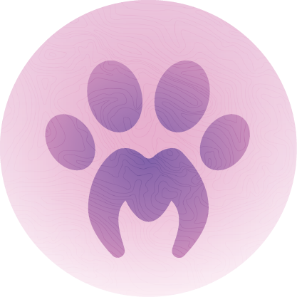

<div align="center">
  
  <h1>meow-zond</h1>
  <p>Открытый Docker-зонд для meow! status: реальные сетевые, веб- и VPN-проверки из вашей сети.</p>
  <p>
    
    
    
    
  </p>
  <p><a href="README.md">English</a> / <strong>Русский</strong></p>
</div>

## Установка

### Windows

Скачайте `meow-zond-windows-amd64.exe` из
[последнего релиза](https://github.com/Riffee/meow-zond/releases/latest) и
запустите двойным щелчком: у процесса будет иконка логотипа сайта. Программа
спросит адрес статус-страницы и имя зонда, подключит зонд и спросит, оставлять
ли его в фоне:

- **Установить фоновую службу с автозапуском** — зонд переживает закрытие окна и
  перезагрузку Windows. Перед созданием службы показывается адрес, куда будут
  уходить данные, и его можно изменить прямо там, поэтому служба не может остаться
  привязанной к старому серверу. Если окно не администратора — появится запрос UAC.
- **Остаться в консоли** — данные отправляются, пока открыто это окно.

Программу можно открыть в любой момент повторно: на первом экране видно состояние
службы, а пункт **4 — Фоновая служба и автозапуск** умеет запускать, останавливать,
выключать автозапуск и удалять службу. Настройки хранятся в
`C:\Users\<вы>\AppData\Local\MeowProbe\probe.json`.

### Linux (.deb)

```bash
sudo dpkg -i meow-zond_1.1.1_amd64.deb
meow-zond                       # подключить зонд и работать через меню
sudo meow-zond -install-service # либо фоновая служба с автозапуском
```

Пакет ставит `/usr/bin/meow-zond`, пиктограмму логотипа, пункт меню и
**выключенную** службу systemd, поэтому ничего само не стартует. Сначала
подключите зонд: пока `/var/lib/meow-zond/probe.json` нет, служба остаётся
выключенной и не перезапускается на пустых настройках:

```bash
sudo systemctl enable --now meow-zond   # запустить и оставить с автозапуском
sudo systemctl stop meow-zond           # пауза, автозапуск остаётся включённым
sudo systemctl disable meow-zond        # после перезагрузки зонд не вернётся
meow-zond                               # то же самое через меню с статусом службы
```

### Контейнер

```bash
curl -fsSL https://raw.githubusercontent.com/Riffee/meow-zond/main/install.sh | sudo bash
```

Установщик клонирует репозиторий в `/opt/meow-zond`, при необходимости
установит Docker, спросит адрес статус-страницы и имя зонда, затем соберёт и
запустит контейнер `meow-zond`. Коды и ключи подключения не нужны.

Взять опубликованный образ вместо сборки из исходников:

```bash
echo 'MEOW_ZOND_IMAGE=ghcr.io/riffee/meow-zond:latest' | sudo tee -a /opt/meow-zond/.env
cd /opt/meow-zond && docker compose up -d --pull always
```

Скрипт: [install.sh](https://raw.githubusercontent.com/Riffee/meow-zond/main/install.sh)

## Открытая регистрация

Любой, кто знает адрес статус-страницы, может зарегистрировать зонд по имени.
Это сделано намеренно: зонд — независимая точка измерений, а не
привилегированный пользователь. Регистрация ограничена по частоте и общему
количеству зондов; назначение зондов мониторам и удаление нежелательных
зондов остаются за администратором.

## Что делает

- Выполняет TCP, ICMP, HTTP, DNS и TLS-проверки из сети зонда.
- Поддерживает опциональные Xray/VLESS/REALITY end-to-end проверки. Xray не
  входит в образ: укажите `xray_path` и `xray_sha256` в `/data/probe.json`
  для отдельно проверенного бинарника.
- Отправляет на статус-страницу только исходящие HTTPS-запросы. Входящие
  порты не нужны.
- Использует `network_mode: host`, чтобы проверки и определение сети шли через
  реальный интернет-путь хоста. Для ICMP и привязки к интерфейсу нужен
  `NET_RAW`; остальные capabilities сброшены, корневая ФС read-only.
- Хранит идентификатор зонда, очередь результатов и настройки в volume
  `meow-zond-data`.

## Логи

```bash
docker compose logs -f meow-zond
docker compose exec meow-zond tail -n 500 /data/probe.log
```

Каждая проверка пишет имя монитора, тип, цель, результат, этап ошибки и
задержку. Секреты, VLESS UUID и Reality-параметры не логируются.

- `/data/probe.log` — кольцевой буфер ровно на **500** последних строк;
- Docker JSON-лог ограничен **64 КБ** и одним ротированным файлом.

## Требования

- Linux-хост с root/sudo.
- Docker Engine и Docker Compose V2. Установщик может поставить Docker.
- Исходящий интернет и HTTPS-доступ к статус-странице.

## Обновление и повторная установка

```bash
cd /opt/meow-zond
git pull
docker compose up -d --build
```

Сбросить конфигурацию зонда и зарегистрироваться заново:

```bash
cd /opt/meow-zond
docker compose down -v
./install.sh
```

`docker compose down` без `-v` сохраняет volume и идентификатор зонда.

## Безопасность

- Зонд получает только типизированные задания проверок и возвращает
  результаты; админ-пароль и токен Remnawave ему недоступны.
- Открытая регистрация означает, что новый зонд может появиться без
  предварительного одобрения. Не публикуйте адрес статус-страницы, если не
  хотите публичных зондов; лишние зонды удаляются в админке.
- В production используйте HTTPS. HTTP разрешён только для локальной
  отладки.

## Структура

```text
cmd/meow-zond          консольное меню, headless-агент, служба Windows и служба systemd
internal/probe         сетевые проверки, Xray и spool
internal/model         общие типы монитора, задания и результата
internal/secure        идентификаторы и хеши
internal/distribution  встроенный адрес сервера для скачиваемых сборок
```

Тесты:

```bash
go test ./...
```

## Лицензия

MIT. См. [LICENSE](LICENSE).
